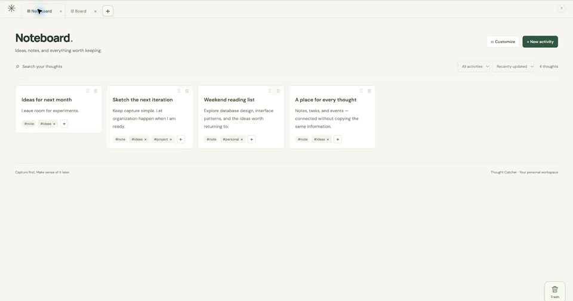
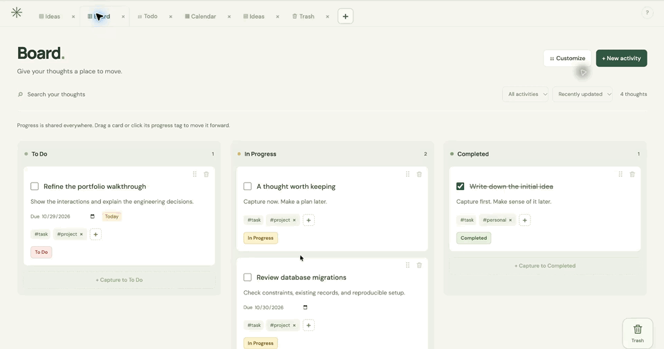
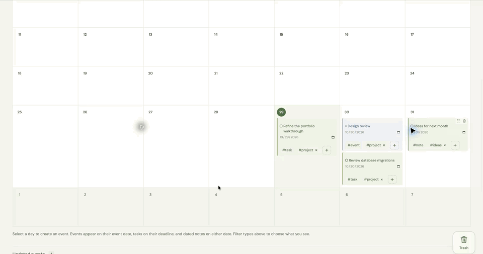
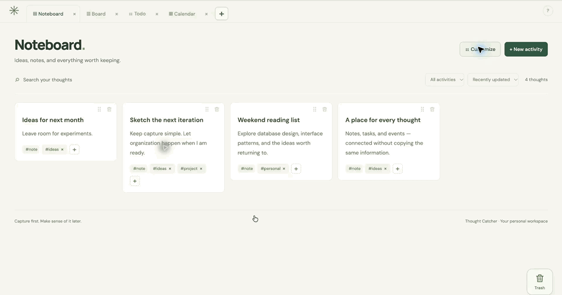
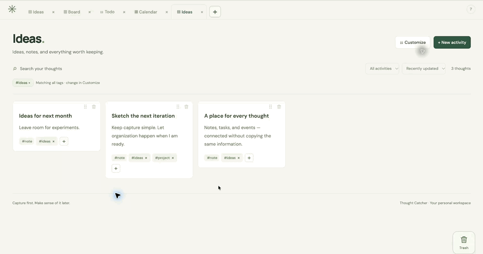

# Thought Catcher

A personal workspace for capturing notes, tasks, and events, then organizing them through a Todo list, Kanban board, Noteboard, and Calendar. Each view works with the same underlying activities, so a change to a task follows it everywhere.

I wanted one place to write down everything I wanted to remember later: a passing thought, a reminder to do something, an event, or a task. I did not always know how I wanted to organize it when I wrote it down. I made Thought Catcher so I could capture the thought first and give it structure later.

This project is also how I am learning to build a complete application across the interface, API, and database. The interesting challenges have been keeping multiple views consistent, making editing feel direct, and preserving information as an activity changes type or moves to Trash.



*Recorded from the running app with fictional demo data and character-by-character typing. [Watch the higher-resolution MP4](docs/media/capture-and-organize.mp4).*

## Tech stack

| Layer | Technologies | Responsibility |
| --- | --- | --- |
| Interface | React, TypeScript, Vite, CSS | Inline editing, pointer dragging, tab navigation, filtering, and view configuration |
| API | Node.js, Express, TypeScript | Activity operations, shared progress, saved views, and Trash/restore |
| Validation | Zod | Runtime validation of request bodies and saved-view configurations |
| Database | PostgreSQL, `pg`, SQL | Activity records, custom labels, saved profiles, constraints, and transactions |
| Migrations | Numbered SQL files and a TypeScript runner | Explicit, ordered migrations tracked by filename and checksum |
| Checks | TypeScript, Node.js test runner, `tsx` | Static checks, focused frontend unit tests, and PostgreSQL-backed API integration tests |

This is a working **local development MVP**. Reminder delivery, AI integration, and public deployment remain future work.

## See it in use

### Shared progress across Todo and Kanban

Drag a task between To Do, In Progress, and Completed. The full card follows the pointer while its original space stays reserved. Todo and every matching Board view reflect the same activity status; reopening a completed task moves it back to To Do.



*[Watch the higher-resolution MP4](docs/media/shared-progress.mp4).*

### Dates without a separate copy of the activity

Calendar shows task deadlines, event dates, and dated notes. Independent type filters let me decide what is visible. Selecting a date creates an event with that date already filled in; events without dates remain accessible in an Undated events shelf.



*[Watch the higher-resolution MP4](docs/media/calendar.mp4).*

### Save a way of looking at the same information

Customize a view's tag filters, sorting, grouping, and visible fields, then save it as a named profile. Multiple selected tags use AND matching. Profiles persist in PostgreSQL and open from the new-tab picker; open tabs and the active tab persist in browser local storage.



*[Watch the higher-resolution MP4](docs/media/saved-views.mp4).*

### Room to change my mind

Moving an activity to Trash preserves its content, labels, dates, and progress. Restore brings back the same record. A visible Trash button provides a keyboard-accessible alternative to dragging.



*[Watch the higher-resolution MP4](docs/media/trash-and-restore.mp4).*

## Engineering decisions

**One activity, multiple views.** Notes, tasks, and events share an activity model. Every record has exactly one type, stored in `activity_type` and exposed as a reserved `note`, `task`, or `event` tag. Custom labels are separate many-to-many relationships. Replacing the type tag changes where the activity appears while preserving its other fields. Kanban is a filtered view of tasks and their shared status.

**Direct editing with recoverable drafts.** Text edits stay inside the card. A new Noteboard note starts as a local blank block and is persisted only after it has a valid title. Existing fields save on blur or a keyboard save command; failed saves keep the draft available to correct or retry. PATCH requests preserve omitted fields.

**Dragging alongside text selection.** I carried the full-card drag interaction forward from my [SwiftUI macOS TodoList](https://github.com/d-kwong/macOS-TodoList). In this browser version, pointer movement creates a floating card after a movement threshold. Valid column and Trash drops commit on release; an outside drop or Escape cancels. Editable text retains native caret placement and selection.

**Validation at the API boundary.** TypeScript describes development-time types; Zod validates incoming values at runtime. PostgreSQL constraints protect stored types and relationships. The browser talks to the API, and only the API accesses database credentials.

**Dates retain their meaning.** Deadlines and event dates are separate `YYYY-MM-DD` calendar dates. Creation, update, and completion times are timestamped instants. This keeps a date-only deadline from shifting because of a timezone conversion.

**Explicit schema evolution.** The migration runner records filenames and checksums, applies pending migrations in order, and rejects changes to applied migrations. Legacy board routes and memberships remain available for compatibility; the current Board UI uses shared task status.

## Run it locally

You need Node.js **22.12 or newer**, npm, and a running **PostgreSQL 13 or newer** server. Use a maintained Node.js release. The PostgreSQL role needs permission to create the application's tables and, for integration tests, an isolated schema.

```sh
git clone https://github.com/d-kwong/thought-catcher.git
cd thought-catcher/backend
npm install
cp .env.example .env
```

Set your local PostgreSQL connection values in `backend/.env`. The example includes `PGHOST`, `PGPORT`, `PGDATABASE`, and `PGUSER`; add `PGPASSWORD` if your server requires it. Local `.env` files are ignored by Git.

Create the database once using your PostgreSQL role, then apply migrations and start the API from `backend`:

```sh
createdb thought_catcher
npm run migrate
npm run dev
```

In a second terminal, from the repository root:

```sh
cd frontend
npm install
npm run dev
```

Open the URL printed by Vite, normally [localhost:5173](http://localhost:5173). The API defaults to port **3000**, and Vite proxies API requests there. If you change the API port, update `frontend/vite.config.ts` as well. `/health` checks the API process, not database connectivity.

Migrations run explicitly, rather than at API startup. Add a new numbered SQL migration instead of editing an applied one. If PostgreSQL command-line tools are unavailable, add your installation's `bin` directory to PATH. Database creation requires a role with `CREATEDB`, or an existing database provided by your administrator.

## Verification

From `backend`:

```sh
npm run typecheck
npm test
npm run build
# Run the compiled API after stopping the development server:
npm start
```

From `frontend`:

```sh
npm run typecheck
npm test
npm run build
```

Backend integration tests use the configured PostgreSQL connection, isolate their data in a schema, and roll back their changes. They exercise migration compatibility, validation, activity updates, shared status, saved-view persistence, and Trash/restore preservation. Frontend tests cover type-tag replacement, label merging, drag thresholds, and valid drop targets. Interactive browser checks are manual; the recordings above are demonstrations, not an automated end-to-end test suite.

Build output goes to `backend/dist` and `frontend/dist`. The development setup runs the frontend and API separately.

## Where the code lives

| Area | Implementation |
| --- | --- |
| Views, inline editors, tabs, and pointer interactions | [`frontend/src/App.tsx`](frontend/src/App.tsx) |
| Type-tag and drag rules | [`frontend/src/tag-rules.ts`](frontend/src/tag-rules.ts), [`frontend/src/drag-rules.ts`](frontend/src/drag-rules.ts) |
| API routes and error handling | [`backend/src/app.ts`](backend/src/app.ts) |
| Activity validation and persistence | [`backend/src/activity-schema.ts`](backend/src/activity-schema.ts), [`backend/src/activities.ts`](backend/src/activities.ts) |
| Saved profiles and legacy board API | [`backend/src/workspace.ts`](backend/src/workspace.ts) |
| Schema migrations and runner | [`backend/migrations/`](backend/migrations/), [`backend/src/migrate.ts`](backend/src/migrate.ts) |
| API integration tests | [`backend/tests/activities.test.ts`](backend/tests/activities.test.ts) |
| Focused frontend tests | [`frontend/tests/`](frontend/tests/) |

The [technical reference](docs/technical-reference.md) includes the full interaction guide, data model, API endpoints and examples, migration compatibility notes, and manual smoke-check workflow. [Recording notes](docs/media/README.md) describe the demo files and capture process.

## Next steps

I want to keep developing the original idea of a place for anything I need to remember. The next areas are reminder delivery and scheduling semantics, authentication and ownership before public hosting, pagination, and richer text editing.

### A conversational way to capture and organize

I also plan to add a chat interface so I can write naturally when a thought does not fit neatly into a form. For example, “Remind me to review my portfolio on Friday” could become a proposed task with a deadline, while a longer message could become a note with suggested labels. The goal is to move from a passing thought to a useful record with less interruption.

Beyond capture, I want to ask questions about what I have already saved: “What do I need to finish this week?” or “Find my notes about project ideas.” Answers would reference the relevant activities and link back to their views. Proposed edits would be reviewable before they change stored records, and chat would use the same validated API operations as the ordinary interface.

This feature is planned. There is no chat or AI integration in the current application. Model selection, retrieval, privacy, and cost controls still need to be designed; reminder delivery is a separate planned capability.
